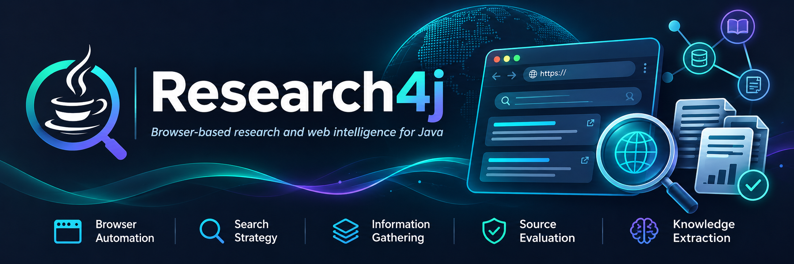

<p align="center"></p>

# Research4j

Browser-based research and web intelligence for Java: browser automation, search strategy, information gathering, source evaluation and knowledge extraction as reusable libraries.

Reusable Java research and browser components extracted from [Ask AI](https://github.com/aresstack/askai). The first extraction (v0.1.0) took commit [3dfeecee](https://github.com/aresstack/askai/commit/3dfeecee60b1ee7db9e7cbead98cef13240ff0b6) of 3 Nov 2026; the module sources now match Ask AI main at [d89d1c5f](https://github.com/aresstack/askai/commit/d89d1c5f) (26 Nov 2026). Ask AI remains unchanged; migration is tracked in [Ask AI #292](https://github.com/aresstack/askai/issues/292).

## Modules

- **research-core** (new, `com.aresstack.research4j`): the source-neutral research of Phase 3. It fills the basket
  (Korb, the contract of [Knowledge4j](https://github.com/aresstack/knowledge4j)) and knows no browser, no search
  engine and no writing. See below.
- browser-api, browser-playwright, browser-search-analysis, browser-static-http
- **browser-tools**: the browser tools of a chat host (`browser_tabs`, `_navigate`, `_read`, `_links`, `_follow`,
  `_back`, `_document`, `_controls`, `_act`, `_screenshot`, `_open_many`, `_mark`, `_close`), one browser per chat with
  its own profile, access rules per profile with the host's question for unknown sites, the question before
  data-changing actions and the progress of a web exploration. Moved from the Enterprise AI Client, see
  [browser-tools/UPSTREAM.md](browser-tools/UPSTREAM.md); its contract (`ChatBrowser`, engine SPI) is in browser-api.
  The engine is `PlaywrightChatEngine` in browser-playwright: a visible browser per chat profile folder (channel
  `msedge`, `chrome` or `camoufox`), with the Enterprise AI Client's page scripts, waiting rules and real input.
- web-search-providers, serp4j-playwright-google
- research-domain, research-agent-runtime
- agent-model-runtime-api, mcp-runtime-api (neutral host contracts)

The original Java packages and resources are retained to minimize migration changes. Java 21 matches the upstream build. The Playwright backend uses playwright4j and requires isolation from older GraalJS versions in host applications.

## Filling the basket (research-core)

`BasketResearch` works only over the neutral ports of Knowledge4j:

1. `ConceptQueryPlanner` writes queries per node of the mind map (concept), inside the fence: the node's base query
   plus a few variants by the model. The concept only steers the search; the basket carries no trace of it.
2. Every query goes to every `SearchChannel` the host offers (its own index, a web search); hits are merged per source.
3. `SourceRouter` reads each new source over the first `FetchChannel` that supports it.
4. `SourceJudge` checks each source against the fence (inside, mixed, outside, unclear). Every source but a clearly
   outside one goes through the host's `SourceKeeper` into the basket; the basket holds references, the host keeps the
   text. Child or linked sources of an accepted source are read in the next round, as deep as the host sets.
5. A node is covered with enough sources from enough sites. Nodes not covered are planned again from another angle.

The research ends at a standstill (rounds without a new source), when every node is covered, or when there is nothing
new to search or read; there is no fixed number of rounds. Every search and read passes the run's `RunGuard`, so the
host's transfer policy is checked on every exit and a refused step is a visible skipped step. The capacity of the
host's model sets how many planner and judge calls run at once: one after the other on one graphics card, side by side
on a cloud service, with the same basket.

Knowledge4j is not released yet. Development uses a Gradle Composite Build with a checkout next to this one
(`../knowledge4j`, or `-Pknowledge4j.dir=<folder>`); the CI checks it out at a fixed commit.

## Build

Resolve Serp4j 0.1.0 and all other external dependencies directly from Maven Central. No local Maven publication is required. Then run:

```sh
bash gradlew clean build
bash gradlew publishToMavenLocal
```

Ask AI host-dependent tests remain in the source tree but are explicitly excluded from the standalone test source set until replaced with host-neutral fixtures. The existing Firefox channel is retained; persistent Firefox profiles, extension loading, intranet access policy and Space Harvester integration require separate validation.

## License

MIT; see LICENSE.

## Verification and releases

The default build runs library tests without a live browser or model. Environment-dependent tests named
`*Live*Test` run separately via `bash gradlew liveTest`. For example, select the installed Firefox with
`ASKAI_TEST_BROWSER_CHANNEL=firefox bash gradlew :browser-playwright:liveTest --tests '*PlaywrightLiveBrowserTest'`.
The host-dependent tests listed in research-agent-runtime/build.gradle still require standalone host fixtures.
Firefox history navigation currently fails with playwright4j 0.3.0 (see https://github.com/aresstack/playwright4j/issues/79).
Do not treat the baseline library as acceptance of the Space Harvester integration.

Build signed release bundles in GitHub Actions on a version tag. Central Portal credentials and signing
keys are supplied by the existing organization secrets. The portal verification timeout is two hours.
Locally, `bash gradlew zipAggregation -PreleaseVersion=0.1.0` builds an unsigned bundle without uploading it.