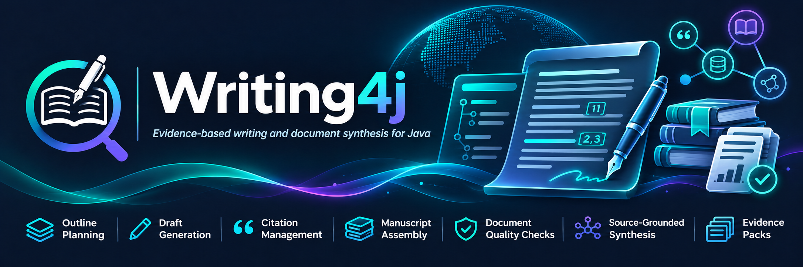

<p align="center"></p>

# Writing4j

Evidence-based writing and document synthesis for Java. Writing4j turns collected sources and passages into a
structured, cited document: outline planning, evidence assignment, section drafting, revision, citation management,
quality checks and manuscript assembly.

> **Status:** in development on `main`, not released. Writing4j depends on
> [Knowledge4j](https://github.com/aresstack/knowledge4j) 0.3.0 from Maven Central.

## From the basket to the book

The input is the basket of sources (`SourceBasket`, references only, read through a `BasketReader`) with the mission
and Weidezaun it was collected for (`SourceBasket.fence()`, inclusions and exclusions) and the writing settings;
nothing else. The fence reaches every step that judges or writes, the section writer included. How the sources were found (a research run of
[Research4j](https://github.com/aresstack/research4j), the user's favourites, a folder) is no input, and no search plan
of the research steers the book. `BookRun` (module `writing-core`) runs:

1. source profiles against the fence; passages outside the fence are set aside before anything else,
2. the cornerstones of the book (`CornerstoneSurvey`): candidates without a model, the terms much more frequent in
   the basket than in the general language (`TermCandidates`, German word list of
   [wordfreq](https://github.com/rspeer/wordfreq), CC BY-SA 4.0, see `wordfreq-de.NOTICE.txt`); a sieve where every
   model the host offers votes, with and without the fence and on different places (`CornerstoneSieve`): safe in,
   safe out and the uncertain middle, with their numbers; the fields of the terms (`FieldCards`) and examples in
   context for each term (`Snippets`: the sentence with its neighbours, heading and source),
3. the reader's choice, optional and never locked: he selects the terms (the safe ones preselected), a term for one
   field only, and deselects whole fields (exclusions of the Weidezaun); a term not chosen gets no questions of its
   own, but its passages stay as evidence. Without the reader the safe terms go on,
4. questions from both sides: those the mission demands, the evaluative and critical ones among them, and the
   outline of the chosen cornerstones in one call (chapters in an order a newcomer understands, each question naming
   the cornerstones it rests on; in parts by field when the model's context is too small; the reader's ordering hints
   go along as a hint); near duplicates merged; all checked against mission and fence,
5. evidence per question,
6. a section plan from the material, the sections written one after another with a writing memory and checked
   sentence by sentence,
7. the mission report: every question answered, only leads, open, a further search needed, or outside the fence.

`BookRun.run` does it all without the reader; a host with a reader calls `prepare`, shows the survey, and calls
`open` with the reader's choice (`CornerstoneSurvey.selected`) and `write`.

**Two operating modes, one code.** The host gives the number of concurrent calls its model takes (`capacity`, from
the model port): 1 for a large model alone on one graphics card, many for a cloud service. Every step but the writing
runs that many calls at once; the order of the work stays the same, and the sections are always written in turn.

## Building

```bash
git clone https://github.com/aresstack/writing4j
cd writing4j && ./gradlew build
```

For work on both libraries at once, a checkout of Knowledge4j in `../knowledge4j` replaces the released one
(Composite Build); another folder is set with `-Pknowledge4j.dir=<folder>`.

## Design principles

- Writing4j has no browser, search engine or Playwright dependency, not even transitively.
- Hosts plug in their own sources, passages, search, embeddings, reranking, model calls and persistence through
  small interfaces; default implementations are optional.
- Source references may point to web pages, internal document IDs or code positions.
- When information is missing, Writing4j reports what it needs and the host decides where to look. Internal content
  is never sent to external search engines automatically.
- Gathering information is the job of [Research4j](https://github.com/aresstack/research4j).

More documentation follows with the first modules.
